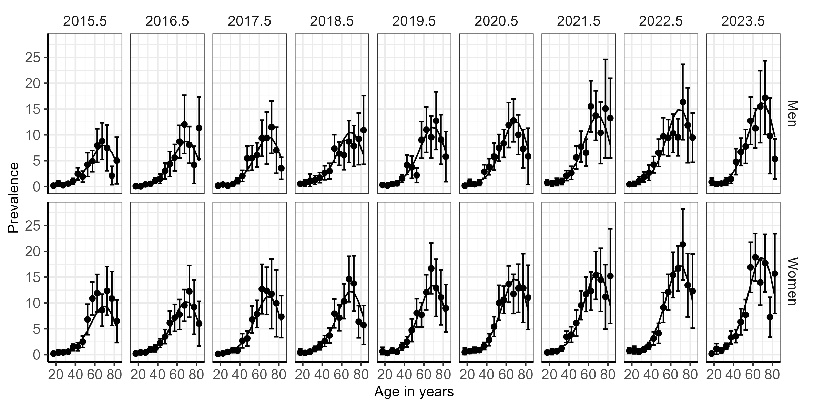
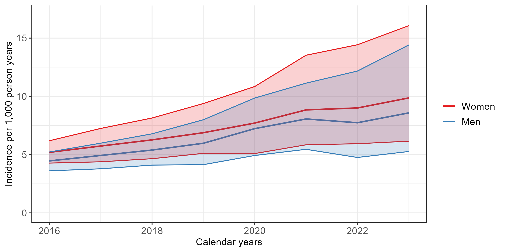
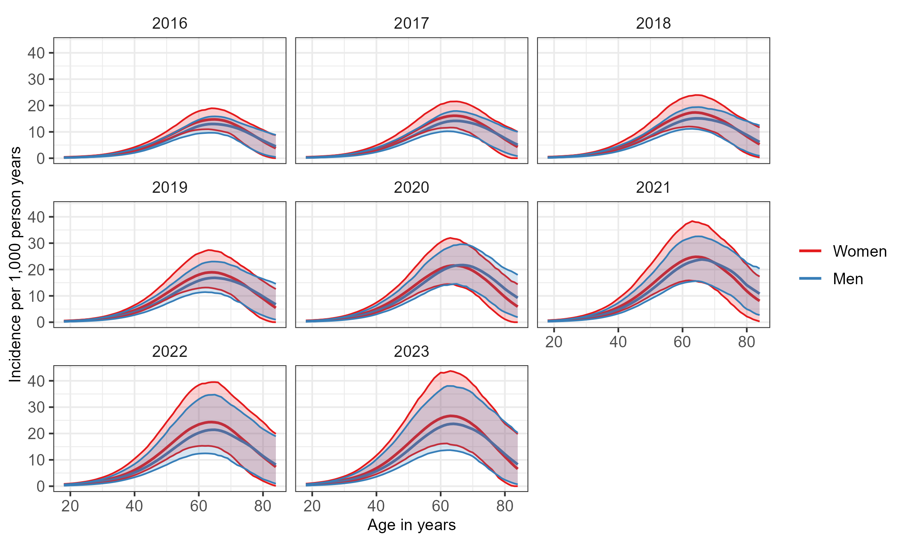

<!--change the format to docx-->

```{=html}
<!-- We agreed to submit the manuscript as a preprint first, but we should save time and effort, so let's format the manuscript for Diabetes Research and clinical practice. Carlos you need to add your Full postal address by the end of line 9.
Here we can check the author guidelines: https://www.diabetesresearchclinicalpractice.com/content/authorinfo
Research article designated as Epidemiology (maximum word count 5000 words). The word limit includes a combined total of five figures or tables with legends -->
```



# Highlights



# Abstract

<!-- max 200 words -->

## Aims

## Methods

## Results

## Conclusions

<!-- The journal encourage including a graphical abstract. I think its a good idea and should be relatively easy to make -->

## Key words

<!-- provide a maximum of 6 keywords -->

Diabetes, epidemiology, disease burden, Peru



# 1. Introduction

The incidence of diabetes mellitus (DM) has increased significantly in recent decades with an age-standardised rate rising from 234 per 100,000 people in 1990 to 285 per 100,000 in 2017 [@liuTrendsIncidenceDiabetes2020]. According to estimates by the International Diabetes Federation, the number of people living with DM in South and Central America is projected to increase to 52 million by 2050 [@internationaldiabetesfederationIDFDiabetesAtlas2021].

Findings from a Peruvian study showed a cumulative incidence of DM of 7.2% and an incidence rate of 19.5 (95% confidence interval \[CI\] 13.9 - 28.3) new cases per 1,000 person-years. These results indicate that the incidence in Peru is among the highest reported worldwide [@seclenElevatedIncidenceRates2017]. However, reports on DM incidence in Peru remain limited, and the few available studies have been conducted primarily in urban populations.

The objective of this study was to estimate age-specific, sex-specific, and age-standardised incidence rates of diabetes in Peru between 2016 and 2023 by implementing the illness–death model.

# 2. Subjects, Materials and Methods

## 2.1 Estimation of input prevalence

An observational study was conducted using cross-sectional data from the Demographic and Family Health Surveys (ENDES) for the period 2015–2023. Based on these surveys, prevalent cases of DM at the national level in Peru were identified. The ENDES survey is conducted annually and is representative of the entire Peruvian territory, providing information on demographic characteristics, health indicators across the life course, communicable and non-communicable diseases, and related determinants <!-- we need to insert a reference here --> [@EncuestaDemograficaSalud]?.

The target population comprises households and their resident members, with data collected by trained personnel who visit the selected households. The instruments for data collection include interviews and laboratory measurements [@EncuestaDemograficaSalud]. Prevalent cases of DM were identified with the questions: "Has a doctor ever diagnosed you with diabetes or 'high sugar' in your blood?". This question offers the response options: "yes", "no", and "don't know/don't remember" [@EncuestaDemograficaSalud]. For the analyses, only participants who respond "yes" or "no" will be included, excluding those who answer "don’t know/don’t remember".

Subsequently, age-specific prevalence of DM was estimated by sex for the years 2016-2023. Age groups were categorized in five-year intervals from 15-19 years <!-- I noticed that we included this age group, are we interested in including this age group? --> up to 80+ years, with 95% CI calculated using logit transformation <!-- Could you please carefully check how CIs/SE were calculated in the Results_ENDESJJJJ excel files? Confidence intervals look symmetric on the prevalence scale, which indicates that no logit transformation was used -->

## 2.2 Estimating the incidence rate of diabetes

To estimate incidence using the approach described below, information on the mortality rate of the general population $m$ and mortality rate ratio (MRR) comparing people with and without DM is required. Since no studies to date have estimated the MRR for Peru, as in previous studies we assumed a log-linear relationship for age and MRR between age with values ranging from 7.5–8.5 at age 30 and 2.5–3.0 at age 80 [@silverman-retanaUsingIllnessdeathModel2024]. For $m$, we used data from the United Nations World Population Prospects <!-- Add REF: United Nations, Department of Economic and Social Affairs, Population Division (2024). World Population Prospects: The 2024 Revision, https://population.un.org/wpp/ --> Both the ENDES survey data and the United Nations mortality data are publicly available and can be accessed here (insert links here).

To estimate the incidence rate of DM for the years 2018-2023, an illness-death model was applied using a partial differential equation. This method has previously been used in the context of chronic non-communicable diseases [@brinksAgeTimedependentModel2014; @hassAgespecificIncidenceNeed2023]. This model is based on a mathematical relationship between the prevalence of DM, the mortality rate in the general population, and the MRR. Transitions between these states are characterized by incidence rates (no diabetes → diabetes) and mortality rates (no diabetes → death; diabetes → death).

The partial differential equation used to estimate the incidence of DM was developed by Brinks and Landwehr [@brinksAgeTimedependentModel2014] and describes the change in prevalence with respect to age and calendar time:

$$
i = \frac{\left( \frac{\partial}{\partial a} + \frac{\partial}{\partial t} \right)p}{1 - p} + m \cdot \frac{p (MRR - 1)}{p (MRR - 1) + 1}
$$ {#eq-PDE}

Where $i$ represents the incidence of DM, $p$ represents the prevalence, and $\left( \frac{\partial}{\partial a} + \frac{\partial}{\partial t} \right)p$ denotes the temporal change in prevalence as a function of age $a$ and calendar time $t$. Therefore, the incidence rate can be calculated from estimates of the prevalence of DM, its temporal change by age and calendar time, the overall mortality rate, and the ratio of mortality rates between individuals with and without DM. 

To smooth the prevalence estimates from the ENDES survey, we regressed the logit-transformed prevalence estimates on age, calender time and sex using linear regression. We allowed for a non-linear relationship between age and the log-odds of prevalence by including a third-degree polynomial for age. Calendar time was included as a linear term. We used expit-transformed predicted values from this linear regression as input prevalence for the partial differential equation. 

To account for uncertainty in the input data, we repeated the estimation of the incidence rate 1,000 times and varied the input prevalence and MRR. For each iteration, we sampled the MRR from a uniform distribution within the ranges described above. For age and sex-specific prevalence estimates, we shifted the point estimates using a random draw from a normal distribution scaled by the corresponding standard errors. From the resulting distribution of incidence estimates, we report the median as point estimate and the 2.5th and 97.5th percentile as 95%-confidence bounds.      

All statistical analyses will be performed in the R software version 4.5.0 [@rcoreteamLanguageEnvironmentStatistical2023].

# Results

During the study period, XXX participants from the ENDES population survey were included; of these, XXX (%) reported having been diagnosed with diabetes by their treating physician (Table 1). Figure 1 shows the prevalence of diabetes by age and sex, estimated from ENDES data using logit-transformed prevalence estimates. These estimates were used as input data in the illness.death model described above, along with the general population mortality rate and the MRR, to obtain the diabetes incidence rate for each year of analysis by sex (Figure 2) and the age-specific rate by sex for each year of analysis (Figure 3).

Between 2016 and 2023, the age-standardized incidence rate (IR) of diabetes showed a sustained increase in both sexes. Among men, the IR rose from 4.46 (95% CI: 3.61 to 5.23) per 1,000 in 2016 to 8.58 (95% CI: 5.27 to 14.41) per 1,000 in 2023, corresponding to an incidence rate ratio (IRR) of 1.93 (95% CI: 1.14 to 3.24) compared with 2016. Similarly, among women, the IR increased from 5.20 (95% CI: 4.27 to 6.19) per 1,000 in 2016 to 9.87 (95% CI: 6.16 to 16.07) per 1,000 in 2023, with an IRR of 1.92 (95% CI: 1.15 to 3.16) relative to the reference year (Table 2).

When stratified by age group and calendar period, the IR increased between 2016 and 2023 across all age groups in both sexes. The oldest age groups exhibited the highest IRs in the population, reaching in 2023 an IR of 22.54 (95% CI: 13.49 to 36.57) per 1,000 among 60-year-old men and 25.76 (95% CI: 16.10 to 43.11) per 1,000 among 60-year-old women. However, analysis of the IRR indicated that the largest and statistically significant relative increases occurred in the younger age groups. Specifically, among 20-year-olds, the IRR was 2.18 (95% CI: 1.00 to 4.21) in men and 2.16 (95% CI: 1.03 to 4.28) in women, while the 30-year-old group showed a similar pattern, with IRRs of 2.13 (95% CI: 1.17 to 3.76) and 2.11 (95% CI: 1.25 to 3.52), respectively (Table 3).

# Discussion

Understanding the epidemiological profile of DM in the Peruvian population is essential for informing public health strategies aimed at prevention and control [@internationaldiabetesfederationHowRegistriesCan2024]. There is a lack of cohort studies conducted in Latin American countries, which makes it unfeasible to directly estimate the incidence of DM. For this reason, this study will apply the illness-death model to estimate diabetes incidence using prevalence data from nationally representative surveys and mortality data from official vital statistics. This model has previously been implemented with Mexican data to calculate DM incidence rates for the period 2003-2015 [@silverman-retanaUsingIllnessdeathModel2024].

This study has some limitations. Diabetes status is defined by self-report and therefore may introduce information bias. Additionally, it is not possible to distinguish between type 1 and type 2 diabetes, which is important given the increasing incidence of type 1 diabetes reported in recent years [@gregoryGlobalIncidencePrevalence2022]. On the other hand, a strength of this study is the use of nationally representative survey data from Peru. These findings will contribute recent estimates of diabetes incidence in Peru, which have not been previously reported and may inform public health planning and resource allocation.

# Acknowledgements

# Funding

<!--This is the journal recommended formatting -->

This work was supported by the National Institutes of Health \[grant numbers xxxx, yyyy\]; the Bill & Melinda Gates Foundation, Seattle, WA \[grant number zzzz\]; and the United States Institutes of Peace \[grant number aaaa\].



# Figures and Tables with legends

## Table 1. Description of the Demographic and Family Health Surveys (ENDES) from Peru for the period 2018–2023

<!--We need to insert a descriptive table here -->

   



## Table 2. Age-standardized incidence rates of diabetes for men and women in Peru for the years 2016-2023, and the temporal change in incidence rates between 2016 and 2023

```{r Table 2, echo=FALSE, message=FALSE, warning=FALSE,error=FALSE}
library(tidyverse)
library(gtsummary)
library(flextable)

inc_standardized <- readRDS(file = here::here("Data/inc.standardized.rds"))

inc_standardized_tbl <- inc_standardized |> 
  mutate(
    Sex = factor(Sex, levels = c("Men", "Women")),
    Year = as.factor(Year),

    # Scale incidence to per 1,000 PY
    inc = inc * 1000,
    inc.lcl = inc.lcl * 1000,
    inc.ucl = inc.ucl * 1000
  )

inc_standardized_tbl <- inc_standardized_tbl  |> 
  mutate(
    `IR (95% CI)` =
      sprintf("%.2f (%.2f–%.2f)", inc, inc.lcl, inc.ucl),

    `IRR (95% CI)` =
      sprintf("%.2f (%.2f–%.2f)", IRR, IRR.lcl, IRR.ucl)
  ) |> 
  select(Sex, Year,
         `IR (95% CI)`,
         `IRR (95% CI)`)

inc_wide <- inc_standardized_tbl  |> 
  pivot_wider(
    names_from = Sex,
    values_from = c(`IR (95% CI)`, `IRR (95% CI)`),
    names_glue = "{Sex} – {.value}"
  ) |> 
  relocate("Women – IR (95% CI)",.after = "Men – IRR (95% CI)")

inc_wide_ft <- inc_wide  |> 
  flextable()  |> 
  autofit()

inc_wide_ft
```

  

## Table 3. Age and sex-specific incidence rates of diabetes in Peru for the years 2016-2023, and the temporal change in incidence rates between 2016 and 2023

```{r Table 3, echo=FALSE, message=FALSE, warning=FALSE,error=FALSE}
inc_agespecific <- readRDS(file = here::here("Data/inc.agespecific.rds"))
inc_agespecific_tbl <- inc_agespecific |> 
  mutate(
    Sex = factor(Sex, levels = c("Men", "Women")),
    Year = as.factor(Year),
    age = as.factor(age),
    # Scale incidence to per 1,000 PY
    inc = inc * 1000,
    inc.lcl = inc.lcl * 1000,
    inc.ucl = inc.ucl * 1000
  )


inc_agespecific_tbl <- inc_agespecific_tbl  |> 
  mutate(
    `IR (95% CI)` =
      sprintf("%.2f (%.2f–%.2f)", inc, inc.lcl, inc.ucl),

    `IRR (95% CI)` =
      sprintf("%.2f (%.2f–%.2f)", IRR, IRR.lcl, IRR.ucl)
  ) |> 
  select(Sex, age, Year,
         `IR (95% CI)`,
         `IRR (95% CI)`)

inc_agespecific_wide <- inc_agespecific_tbl  |> 
  pivot_wider(
    names_from = Sex,
    values_from = c(`IR (95% CI)`, `IRR (95% CI)`),
    names_glue = "{Sex} – {.value}"
  )

inc_agespecific_wide <- inc_agespecific_wide |> 
  relocate("Women – IR (95% CI)", .after = "Men – IRR (95% CI)")

inc_agespecific_wide_ft <- inc_agespecific_wide  |> 
  flextable()  |> 
  autofit()

inc_agespecific_wide_ft
```



# References
